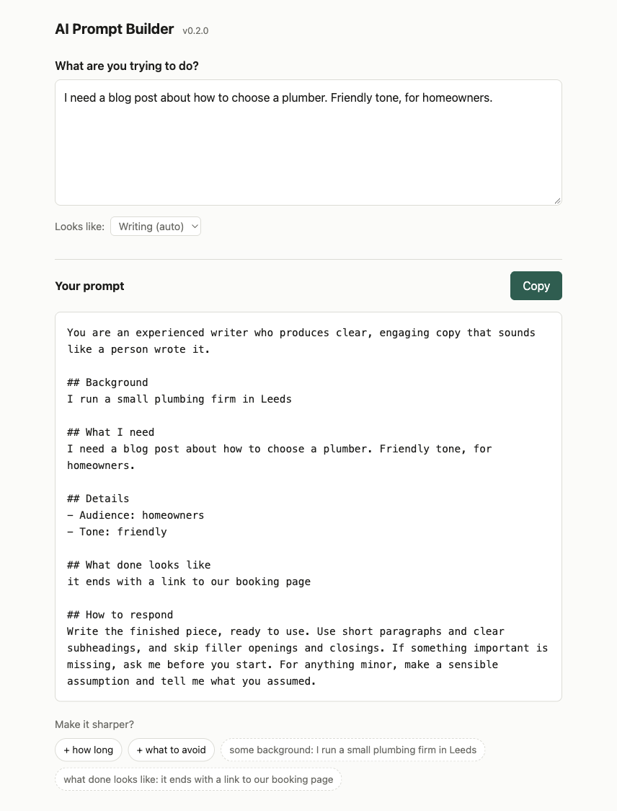

# AI Prompt Builder

Type what you want in your own words. Get back a prompt worth pasting
into Claude, ChatGPT or anything else.

No account, no sign-in, no API key, and nothing to install.

<picture>
  <source media="(prefers-color-scheme: dark)" srcset="assets/screenshot-dark.png">
  
</picture>

## Try it

**https://jonimmswordpressdev.github.io/ai-prompt-builder/**

Bookmark it and you're done.

## What it actually does

Asking an AI for "a blog post about plumbers" gets you something
generic, because you left out everything that mattered: who it's for,
what it should sound like, how long, what finished looks like.

Type the same thing here and you get a prompt that says who the AI
should be, what you need, and the details that matter: who it's for,
the tone, the length, the deadline. The important bit is the ending.
It tells the AI to ask you first if something big is missing, and to
say what it assumed about anything small, instead of quietly guessing.

It works out what kind of job you've described and shows you its
guess. If it's wrong, change it with one click.

Underneath your prompt sit a few optional suggestions, picked for the
kind of job: some background for a blog post, your setup for a coding
problem, what data you have for an analysis. Tap one, type a few
words, and it folds into the prompt. Ignore them and nothing is lost.

Not sure where to start? Tap one of the examples under the empty box.

Every prompt you copy is kept in a short "Recent prompts" list at the
bottom of the page, so you can pick one back up later. One click
clears it.

## Nothing leaves your browser

There is no server, no account, and no network request of any kind.
Your work and your recent prompts are saved in that browser on that
device so a refresh doesn't lose them. Closing the tab loses nothing.

## Prefer a file you keep?

Download `prompt-builder.html` from the [latest
release](https://github.com/JonImmsWordpressDev/ai-prompt-builder/releases/latest)
and double-click it. One file, no folder, no installer. It works with
no internet connection, from a USB stick, or from a shared drive,
and it behaves identically to the hosted link.

## Used an earlier version?

Versions before this one had an optional "Polish" feature that stored
an Anthropic API key in your browser. That feature is gone and this
version never reads that key, but it cannot delete it either. If you
ever entered one, clear this site's data in your browser settings to
remove it.

## Build it yourself

You don't need this to use the tool. It's here if you want to change
it or check what it does.

    npm run dev      dev server at http://127.0.0.1:4518
    npm run build    writes dist/prompt-builder.html
    npm test         runs the test suite

Needs Node 18 or newer. There are no dependencies, so there is nothing
to install first. The whole tool is one HTML file with inline CSS and
JavaScript, built from the small modules in `src/`.

## License

MIT. See `LICENSE`.
